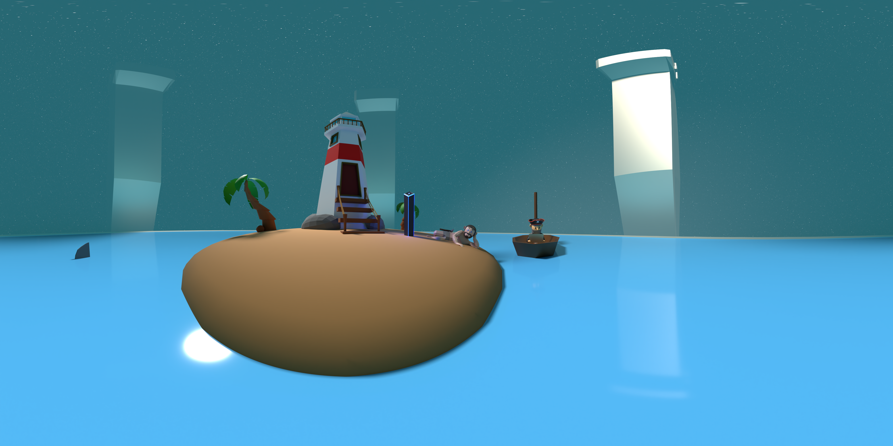

# el-meu-projecte-ar
Per aquest projecte els models 3D i imatges que apareixen en la web estan totalment fets per mi. He aprofitat un escenari que vaig fer fa un temps en Blender, he afegit la càmera per fer la imatge en 360°.

Després he animat les aletes dels taurons per a poder renderitzar el vídeo, cosa que ha tardat unes +3 hores.

